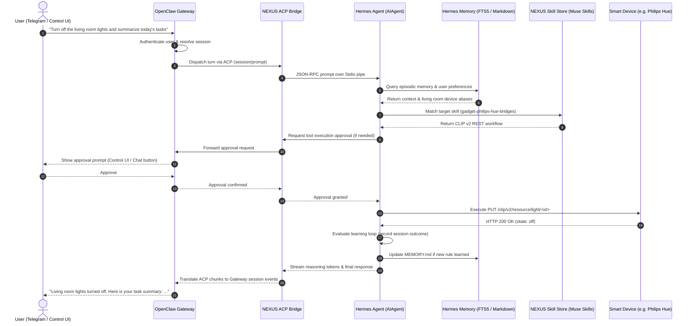

# NEXUS System Design: Architectural Blueprint & Integration Specification

**System Name:** NEXUS Modular AI Ecosystem  
**Target Architecture:** Multi-Repository Composition (OpenClaw + Hermes + Muse)  
**Document Status:** Architectural Design & Integration Specification (Phase 2 Deliverable)  
**Date:** November 1, 2026  
**Auditor:** Senior Software Architect & Repository Analysis Engineer  

---

## 1. System Vision & High-Level Architecture

NEXUS is a modular, privacy-first AI ecosystem that synthesizes the distinct superpowers of three state-of-the-art open-source projects while preserving their independent source trees and upstream maintainability:

```text
┌─────────────────────────────────────────────────────────────────────────────┐
│                            NEXUS ECOSYSTEM MAP                              │
├─────────────────────────────────────────────────────────────────────────────┤
│                                                                             │
│  1. OPENCLAW: The Interaction & Ingress Hub                                │
│     • Multi-channel messaging: Discord, Telegram, Slack, WhatsApp, Signal  │
│     • Control UI (SolidJS) & Admin Dashboard                               │
│     • User authentication, channel routing, session management             │
│     • Human-in-the-Loop approval interface & mobile device pairing         │
│                                                                             │
│         ▲                                                           ▲       │
│         │ ACP JSON-RPC over Stdio                                   │ Local │
│         ▼                                                           │ HTTP  │
│                                                                     │       │
│  2. HERMES AGENT: The Cognitive & Learning Core                     │       │
│     • Autonomous tool-calling reasoning loop                        │       │
│     • Closed learning loop (self-synthesizing & refining skills)    │       │
│     • Deep episodic memory (SQLite FTS5 + Honcho user modeling)     │       │
│     • Hierarchical subagent delegation with isolated worktrees      │       │
│                                                                     │       │
│         ▲                                                           │       │
│         │ Skill Ingestion & Link Protocol                           │       │
│         ▼                                                           │       │
│                                                                     │       │
│  3. MUSE GADGET SDK: The Edge & IoT Execution Engine                │       │
│     • 46+ smart home device integration skills (Agent Skills standard)      │
│     • Local Noise XX / Link-Control protocol adapter                        │
│     • Edge hardware & desktop UI simulator (SDL2/LVGL)                      │
│                                                                             │
└─────────────────────────────────────────────────────────────────────────────┘
```

---

## 2. Existing Functionality vs. Proposed New Functionality

To maintain absolute architectural clarity, the table below explicitly delineates what already exists in the repositories versus what NEXUS will introduce:

| Subsystem | Existing Upstream Functionality | Proposed New NEXUS Functionality |
| :--- | :--- | :--- |
| **OpenClaw** | • 20+ messaging channel connectors<br>• SolidJS Web Control UI<br>• `packages/acp-core` & `extensions/acpx`<br>• `extensions/migrate-hermes`<br>• `extensions/muse` (agent harness)<br>• Tool approval runtime | • Lightweight `@openclaw/nexus-bridge` plugin to register Hermes as the default native cognitive harness over ACP.<br>• Configuration profile binding channel ingress directly to the Hermes ACP session. |
| **Hermes Agent** | • `AIAgent` core execution loop<br>• `acp_adapter` (standard JSON-RPC over stdio)<br>• SQLite FTS5 CJK memory store<br>• Honcho user modeling (`USER.md`)<br>• Subagent delegation engine<br>• AST-audited skill learning loop | • Headless launch profile (`nexus-hermes-runner`) managed by `uv`.<br>• Skills loader configuration mounting the shared `nexus-skills/` directory. |
| **Muse Gadget** | • 46+ LAN smart home device skills<br>• ESP32 firmware & C desktop simulator<br>• `linux/src/musegadget` Noise XX client<br>• `FakeVm` in-process test server | • `nexus-virtual-hub`: A lightweight local daemon adapting `FakeVm` to terminate local Muse gadget connections without Meta cloud.<br>• Direct mounting of the 46+ `SKILL.md` files into Hermes/OpenClaw. |

---

## 3. End-to-End System Execution Flow

The sequence diagram below illustrates the exact end-to-end execution of a user command through NEXUS:



---

## 4. Physical Directory & Workspace Topology

To strictly preserve upstream git maintainability, NEXUS leaves the three source repositories untouched and creates a parent orchestrator structure:

```text
A:\Mixer\
├── openclaw-main\                  # Untouched Upstream OpenClaw Repository
│   └── openclaw-main\              # Node.js 24 / pnpm monorepo
├── hermes-agent-main\              # Untouched Upstream Hermes Repository
│   └── hermes-agent-main\          # Python 3.14 / uv monorepo
├── muse-gadget-sdk-main\           # Untouched Upstream Muse Gadget Repository
│   └── muse-gadget-sdk-main\       # Embedded C & Python SDK
│
└── nexus\                          # NEW: NEXUS Orchestration & Bridge Layer
    ├── config\                     # Unified configuration profiles
    │   ├── openclaw.nexus.json     # OpenClaw configuration loading Hermes harness
    │   └── hermes.nexus.yaml       # Hermes configuration loading shared skills
    ├── plugins\                    # Non-invasive OpenClaw plugins
    │   └── openclaw-nexus-bridge\  # Thin ACP bridge connecting OpenClaw to Hermes
    ├── skills\                     # Unified NEXUS Skill Store
    │   ├── core\                   # Core system skills
    │   ├── learned\                # Hermes-synthesized skills
    │   └── gadgets\                # Symlinked / mounted Muse 46+ device skills
    ├── memory\                     # Dedicated workspace memory roots
    │   ├── openclaw-transcripts\   # OpenClaw SQLite databases
    │   └── hermes-state\           # Hermes FTS5 databases & MEMORY.md
    └── run-nexus.ps1               # Automated launcher script (starts services safely)
```

---

## 5. Deployment & Runtime Model

### 5.1. Operating System & Runtime Distribution

1. **Host Native Windows 11 (Primary Runtime):**
   - **OpenClaw Gateway:** Runs natively on Windows using Node.js v24.18.0.
   - **Hermes Agent ACP Engine:** Runs natively on Windows using Python 3.14.3 and `%LOCALAPPDATA%\hermes\bin\uv.exe`.
   - **Communication:** Standard I/O anonymous pipes via ACP (zero network port exposure, zero firewall prompts).
2. **WSL2 Ubuntu (Optional Edge & Simulation Services):**
   - **Muse ESP32 UI Simulator:** Built and executed inside the existing WSL2 Ubuntu environment, rendered directly to the Windows desktop via WSLg.
   - **Linux D-Bus/BlueZ Mock Services:** Run inside WSL2 if local BLE peripheral emulation is requested.

---

## 6. Phase 3 Implementation Roadmap

Now that the deep feasibility audit is complete, the following actionable sequence is ready for Phase 3 execution upon user approval:

```text
Phase 3.1: Environment Preparation (Non-Destructive)
   • Install pnpm on host (via corepack or npm) to enable OpenClaw building.
   • Initialize isolated Python virtual environment via uv for Hermes.

Phase 3.2: Skill Store Assembly
   • Create `nexus/skills/gadgets/` and link the 46+ Muse device skills.
   • Verify Hermes `skill_manager` and OpenClaw skill loaders can index them.

Phase 3.3: ACP Bridge Configuration
   • Configure OpenClaw's ACPX to register `hermes-acp` as a native model provider.
   • Test round-trip ACP conversation: OpenClaw CLI -> Hermes ACP -> OpenClaw CLI.

Phase 3.4: Memory Synchronization Hook
   • Leverage `extensions/migrate-hermes/memory.ts` logic to sync Hermes `MEMORY.md` into OpenClaw's workspace index.

Phase 3.5: Comprehensive Integration Testing
   • Execute end-to-end multi-channel turns with tool execution approvals.
```

