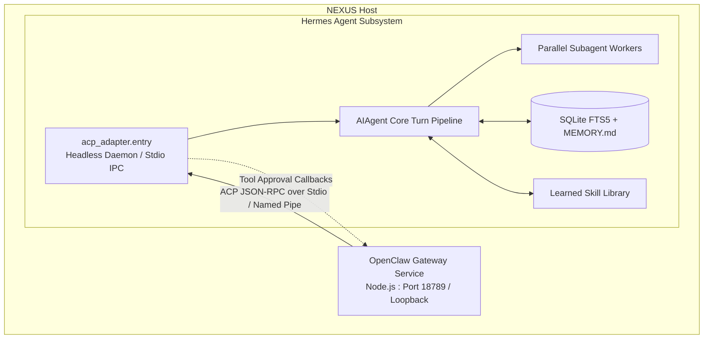

# NEXUS Integration Analysis: Hermes Agent Architecture & Independent Service Operation

**Project:** Hermes Agent (`hermes-agent-main\hermes-agent-main`)  
**Version:** Core `0.0.0` / Monorepo `1.0.0`  
**License:** MIT  
**Maintainer:** Nous Research  
**Analysis Date:** November 1, 2026  
**Auditor:** Senior Software Architect & Repository Analysis Engineer  

---

## 1. Executive Summary

Hermes Agent is an advanced, self-improving AI agent runtime developed by Nous Research. Built in Python (targeting Python `>=3.11,<3.15`, with host running Python 3.14.3 and `uv`), Hermes distinguishes itself through:
1. A **closed learning loop** that autonomously synthesizes, refines, and persists skills from runtime task experience.
2. A **hierarchical subagent delegation system** with isolated worktrees and concurrency controls.
3. A **deep memory engine** combining SQLite FTS5 full-text indexing, Honcho dialectic user modeling, and agent-curated markdown memories.
4. An **integrated Agent Client Protocol (ACP) server** (`acp_adapter`), allowing it to serve external client harnesses over standard JSON-RPC.

This analysis investigates Hermes's core components from source to determine how it can be operated as an **independent, headless cognitive agent service** orchestrated by NEXUS.

---

## 2. Core Architectural Subsystems

### 2.1. Core Agent Execution Loop (`run_agent.py`, `agent/turn_*.py`)

Hermes structures its agent execution through `AIAgent` in `run_agent.py` and a modular pipeline of turn processors in `agent/`:

```text
User Request
    │
    ▼
[turn_preflight.py] ──────────► Checks session health, context limits & loop gates
    │
    ▼
[turn_request_assembly.py] ───► Compiles system prompt, personality, tools & memory context
    │
    ▼
[turn_api_call.py] ───────────► Dispatches to LLM provider (OpenAI SDK / vLLM / local endpoint)
    │
    ▼
[turn_response_intake.py] ────► Parses response, reasoning tokens, and structured tool calls
    │
    ▼
[turn_tool_round.py] ─────────► Dispatches tools, enforces approval gates & collects results
    │
    ▼
[turn_finalizer.py] ──────────► Writes message history, triggers memory nudges & compression
    │
    ▼
Final Response
```

#### Grounded Source Findings:
- **`run_agent.py` (`AIAgent`):**
  Orchestrates the conversation loop, managing active toolsets, context compression (`ContextCompressor`), session state persistence, and interrupt handling.
- **`turn_context.py` & `turn_context_compaction.py`:**
  Performs dynamic context pruning and token estimation. When conversation history nears model context boundaries, it compresses older turns into synthesized episodic summaries (`COMPRESSED_SUMMARY_METADATA_KEY`), maintaining continuity without losing critical instructions.
- **Session Decoupling:**
  Hermes can run headless without interactive terminal prompts via `run_agent.py` or through the ACP server (`acp_adapter/server.py`), making it ready for automated service hosting.

---

### 2.2. Memory Architecture (`hermes_state*.py`, `plugins/memory/`)

Hermes employs a multi-tiered memory architecture designed for long-term agent autonomy:

```text
┌────────────────────────────────────────────────────────┐
│               Hermes Memory Hierarchy                 │
├───────────────────────┬────────────────────────────────┤
│ 1. Ephemeral Context  │ In-memory turn history, prompt │
├───────────────────────┼────────────────────────────────┤
│ 2. Session FTS5 Index │ SQLite messages table with     │
│                       │ CJK-bigram / trigram indexing  │
├───────────────────────┼────────────────────────────────┤
│ 3. Agent Curated Files│ MEMORY.md (facts/instructions) │
│                       │ USER.md (user profile model)   │
├───────────────────────┼────────────────────────────────┤
│ 4. Dialectic Modeling │ Honcho user/agent interaction  │
│                       │ representation engine          │
└───────────────────────┴────────────────────────────────┘
```

#### Grounded Source Findings:
- **SQLite FTS5 Full-Text Indexing (`hermes_state_fts.py`, `hermes_state_search.py`):**
  Uses SQLite WAL mode (`hermes_state_wal.py`) and a virtual table `messages_fts_cjk` with the `cjk_unicode61` tokenizer. It indexes role, content, tool names, and tool calls across all sessions, allowing cross-session semantic search via BM25 ranking.
- **Structured Knowledge Files:**
  Maintains curated, human-readable markdown summaries:
  - `MEMORY.md`: Domain knowledge, learned constraints, project conventions.
  - `USER.md`: Discovered user preferences, communication habits, technical proficiency.
- **Periodic Memory Nudges:**
  During turn finalization, Hermes evaluates whether novel conventions or facts were learned and nudges the model to update `MEMORY.md` or `USER.md` via file-ops tools.

---

### 2.3. Autonomous Skill Creation & Improvement (`tools/skill_manager_tool.py`, `skills_*.py`)

Unlike static toolboxes, Hermes treats skills as mutable, executable assets:

#### Grounded Source Findings:
- **Dynamic Skill Manager (`tools/skill_manager_tool.py`):**
  Exposes tool operations for the agent to autonomously `create`, `edit`, `patch`, or `delete` skills within its `skills/` directory.
- **Skill Structure:**
  Follows the standard Agent Skills schema (`SKILL.md` with YAML frontmatter + optional `scripts/`, `references/`, `templates/`).
- **Safety & AST Auditing (`tools/skills_ast_audit.py`, `tools/skill_linter.py`):**
  Before executing or committing a new skill containing Python scripts, Hermes passes the code through AST static analysis to reject dangerous calls (e.g., unauthorized process spawning, raw socket operations, or destructive filesystem actions).
- **External Hub Synchronization (`tools/skills_hub_clawhub.py`):**
  Hermes includes native integration with **ClawHub** (OpenClaw's public skill registry), allowing it to query and download OpenClaw skills directly!

---

### 2.4. Subagent Delegation Architecture (`tools/delegate_tool*.py`)

Hermes features an industrial-grade subagent delegation framework:

#### Grounded Source Findings:
- **Subagent Spawning (`tools/delegate_tool.py`):**
  Spawns child `AIAgent` instances with isolated conversation histories, dedicated task IDs, and filtered toolsets (`DELEGATE_BLOCKED_TOOLS`).
- **Parallel Batch Execution (`tools/delegate_tool_dispatch.py`):**
  Supports single-task delegation and parallel batch mode (`_Batch`), running multiple subtasks concurrently while the parent orchestrator waits for collected summaries.
- **Worktree Isolation (`tools/subagent_worktree.py`):**
  Children can be assigned isolated Git worktrees or temporary directories to perform edits without corrupting the parent's working directory.
- **Governance & Limits (`tools/delegate_tool_config.py`):**
  Enforces recursion limits (`_get_max_spawn_depth`, defaulting to prevent infinite recursion), concurrency caps (`_get_max_concurrent_children`), execution timeouts (`_get_child_timeout`), and interactive tool approvals.

---

### 2.5. ACP Adapter (`acp_adapter/entry.py`, `server.py`)

The most important integration surface for NEXUS is Hermes's native ACP implementation.

#### Grounded Source Findings:
- **Protocol Contract (`acp_adapter/server.py`):**
  Implements the standard Agent Client Protocol (`acp.schema`) using JSON-RPC 2.0 over standard I/O (stdio).
- **Supported ACP Methods:**
  - `initialize`: Advertises agent capabilities, model lists, and session capabilities.
  - `session/new`, `session/load`, `session/resume`, `session/fork`: Full session lifecycle management.
  - `session/set_mode`: Switches execution modes (e.g., `plan`, `normal`).
  - `session/set_model`: Dynamically reconfigures model parameters.
  - `session/prompt`: Main turn loop streaming `AgentMessageChunk`, `TextContentBlock`, and `UsageUpdate`.
- **Approval Callbacks (`acp_adapter/permissions.py`):**
  Translates Hermes's internal tool approval checks into ACP permission requests forwarded to the calling client.
- **MCP Client Injection:**
  Can ingest client-provided MCP server definitions (`McpServerStdio`, `McpServerHttp`, `McpServerSse`) and register them into the agent's toolset for the turn.

---

### 2.6. Gateway Architecture (`gateway/run.py`, `gateway/platforms/`)

Hermes possesses its own multi-platform messaging gateway (`gateway/run.py`), providing integrations for Telegram, Discord, Slack, WhatsApp, Signal, and Matrix.

#### NEXUS Architectural Decision:
- In NEXUS, running two competing channel gateways (OpenClaw and Hermes) would result in port conflicts, duplicate bot connections, and fragmented message delivery.
- **Recommendation:** **Deactivate Hermes's channel gateway in favor of OpenClaw's Gateway.** OpenClaw has broader channel support (20+ platforms) and native mobile companion node connections. Hermes should be operated purely as an **Agent Execution Engine** communicating with OpenClaw via ACP or MCP.

---

## 3. How Hermes Operates as an Independent NEXUS Service



### Operational Modes for NEXUS:

1. **Subprocess Daemon Mode (Recommended):**
   OpenClaw's `@openclaw/acpx` or a dedicated NEXUS harness spawns Hermes via:
   ```powershell
   & "C:\Users\bavik\AppData\Local\hermes\bin\uv.exe" run --project "a:\Mixer\hermes-agent-main\hermes-agent-main" python -m acp_adapter.entry
   ```
   OpenClaw communicates directly with Hermes via standard I/O pipes. Zero open network ports, native process lifecycle management, automatic teardown on gateway exit.

2. **Dedicated Headless Service Mode (Alternative):**
   Hermes runs as a background Windows service or long-lived daemon listening on a local loopback Unix socket or localhost port, serving ACP or HTTP REST requests to OpenClaw.

