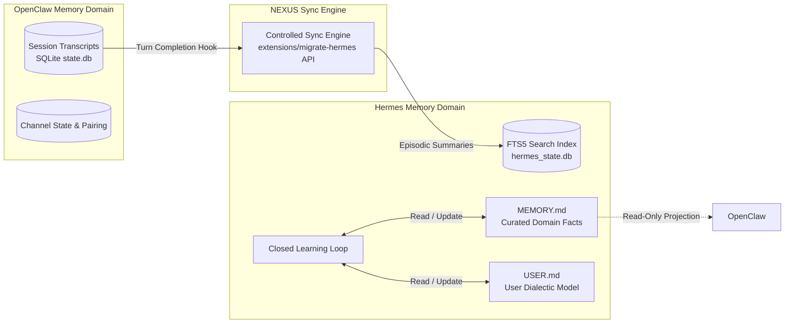

# NEXUS Architecture: Memory & Skills Subsystem Design

**Context:** NEXUS Multi-Repository Architecture Evaluation  
**Projects Analyzed:** OpenClaw, Hermes Agent, Muse Gadget SDK  
**Analysis Date:** November 1, 2026  
**Auditor:** Senior Software Architect & Repository Analysis Engineer  

---

## 1. Executive Summary

A core challenge in creating NEXUS is uniting the memory and skill models of three disparate codebases without creating race conditions, split-brain knowledge corruption, or redundant execution loops.

- **OpenClaw** manages session-centric SQLite databases (schemas 38/39) and workspace markdown files, prioritizing channel transcripts and user access controls.
- **Hermes Agent** manages an autonomous learning loop, persisting episodic memories to SQLite FTS5 (`messages_fts_cjk`), dialectic user models in Honcho, and curated markdown knowledge in `MEMORY.md` and `USER.md`.
- **Muse Gadget SDK** provides a catalog of 46+ edge device skills following the Agent Skills standard.

This document establishes the **NEXUS Memory and Skills Architecture**, recommending **separate, dedicated memory ownership with controlled synchronization** and a **unified, deduplicated skill registry**.

---

## 2. Skills Subsystem Architecture

### 2.1. Skill Standard Compatibility
All three projects already conform to the open **Agent Skills specification** (`SKILL.md` format):

```yaml
---
name: skill-identifier
description: Clear, actionable description of when and how to trigger the skill.
---
# Markdown Instruction Body
Workflow, commands, safety constraints, and validation criteria.
```

- **OpenClaw Source:** Discovers skills in `skills/` and extensions via `openclaw/plugin-sdk/skills`.
- **Hermes Source:** Discovers skills across org trees, audits Python scripts with AST (`tools/skills_ast_audit.py`), and connects to ClawHub (`tools/skills_hub_clawhub.py`).
- **Muse Source:** Houses 46+ skills in `skills/` (e.g., `gadget-philips-hue-bridges/SKILL.md`, `gadget-sonos-speakers/SKILL.md`, `gadget-google-cast/SKILL.md`).

### 2.2. Unified Skill Registry Architecture for NEXUS

Rather than maintaining three divergent skill folders, NEXUS establishes a **Single Source of Truth (SSOT) Skill Store**:

```text
NEXUS Workspace Root (A:\Mixer\nexus-skills\)
├── core/                # System instructions & coding skills (from OpenClaw)
├── learning/            # Agent-created & refined skills (from Hermes skill_manager)
└── gadgets/             # 46+ IoT & edge device skills (from Muse Gadget SDK)
```

#### Shared Registry Mechanics:
1. **Direct Ingestion of Muse Skills:**
   All 46 skills from `muse-gadget-sdk/skills/` are mounted directly into the NEXUS skill store. Because these skills define HTTP/REST/LAN interactions, both Hermes and OpenClaw can execute them natively.
2. **Preventing Duplicate Skill Execution:**
   - In NEXUS, **Hermes is designated as the primary reasoning agent**.
   - OpenClaw's internal tool dispatcher deactivates direct tool execution for skills that are delegated to Hermes.
   - Skill invocation flows strictly in one direction:
     ```text
     User Message (OpenClaw Channel) ──► Hermes Agent (via ACP) ──► Skill Selection ──► Single Execution
     ```
   - When Hermes invokes a tool from a skill, it executes under Hermes's tool runner with approval checks, preventing OpenClaw from attempting a parallel execution.

---

## 3. Memory Subsystem Architecture

### 3.1. Analysis of Existing Memory Systems

| Attribute | OpenClaw Memory System | Hermes Memory System |
| :--- | :--- | :--- |
| **Primary Storage** | SQLite (`state.db`, tables: `sessions`, `messages`) | SQLite (`hermes_state.db`, `state.db`) + FTS5 virtual table |
| **Search Mechanism**| Keyword match / Vector plugins (LanceDB, Wiki) | Full-text search with CJK-bigram & trigram tokenizers |
| **User Modeling**   | Channel user mapping & permissions | Honcho dialectic user representation (`USER.md`) |
| **Agent Knowledge** | Workspace markdown (`workspace/memory/`) | Curated domain knowledge (`MEMORY.md`) + automatic nudges |
| **Schema Versions** | State: 38, Agent: 39 | Versioned migrations in `hermes_state_schema.py` |

### 3.2. Why Direct Database Sharing Must Be Rejected
Directly pointing both OpenClaw and Hermes to the same SQLite database file would cause catastrophic failure:
1. **Schema Incompatibility:** OpenClaw's DDL and Hermes's DDL use different table structures, column names, and migration version tracking for `messages` and `sessions`.
2. **Locking Contention:** Both systems use SQLite WAL mode with process-level lock management (`hermes_state_wal.py`, OpenClaw async locks). Concurrent uncoordinated writes from Node.js and Python would trigger `SQLITE_BUSY` deadlocks.
3. **Trigger Conflicts:** Hermes attaches custom FTS5 update triggers (`messages_fts_cjk_insert`) that expect specific column layouts.

### 3.3. Recommendation: Separate Memories with Controlled Synchronization

NEXUS implements **Domain-Partitioned Memory Ownership**:



#### Memory Ownership Rules:
1. **Session & Channel History (OpenClaw Owns):**
   - OpenClaw owns real-time channel messages, user identities across platforms, and session transcript trees.
   - When a turn completes, OpenClaw provides the normalized turn transcript to Hermes over ACP.
2. **Deep Knowledge & User Modeling (Hermes Owns):**
   - Hermes maintains `MEMORY.md` (project conventions, learned facts) and `USER.md` (user preferences and behavioral traits).
   - Hermes's background learning loop analyzes conversations and refines these files without interference.
3. **Controlled Synchronization via `migrate-hermes` Engine:**
   - At startup or on scheduled sync, NEXUS uses the mechanisms verified in `openclaw/extensions/migrate-hermes/memory.ts` to mirror Hermes's curated `MEMORY.md` into OpenClaw's workspace index (`<workspaceDir>/memory/imports/hermes/MEMORY.md`).
   - This gives OpenClaw visibility into agent memory for prompt compilation while preserving Hermes as the authoritative author.

### 3.4. Conflict Resolution Protocol
When conflicting facts arise between OpenClaw and Hermes:
1. **Timestamped Fact Attribution:** Every memory entry recorded by Hermes carries an origin timestamp and session ID.
2. **Hermes Authoritative for Knowledge:** In matters of technical conventions, tool habits, or domain facts, Hermes's `MEMORY.md` supersedes OpenClaw session scratchpads.
3. **OpenClaw Authoritative for Channel Identity:** In matters of user authorization, channel IDs, and platform permissions, OpenClaw is strictly authoritative.
4. **Explicit Conflict Flagging:** If Hermes's memory update detects an explicit contradiction with an existing entry, it writes a `[CONFLICT-NEEDS-REVIEW]` tag into `MEMORY.md` rather than silently overwriting.

