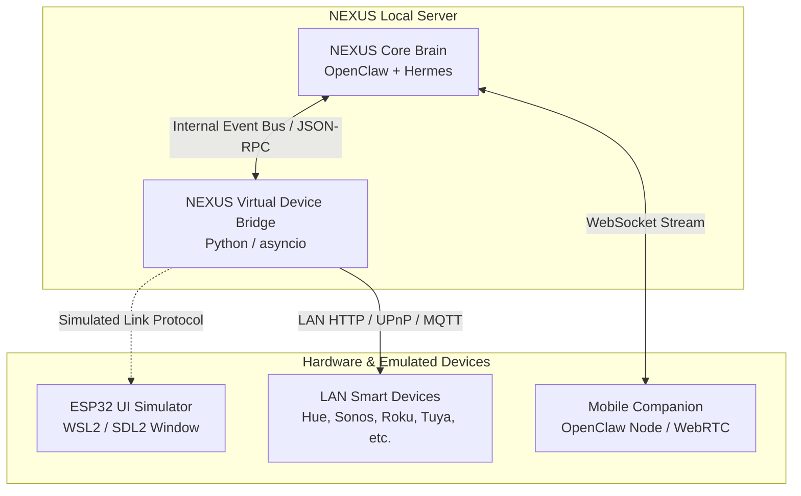

# NEXUS Integration Analysis: Muse Gadget SDK Feasibility & Software-Only Adaptation

**Project:** Muse Gadget SDK (`muse-gadget-sdk-main\muse-gadget-sdk-main`)  
**Version:** `0.1.0` (Linux SDK `musegadget`)  
**License:** Apache-2.0 (with third-party components under MIT/BSD/CC0)  
**Maintainer:** Meta Platforms, Inc.  
**Analysis Date:** November 1, 2026  
**Auditor:** Senior Software Architect & Repository Analysis Engineer  

---

## 1. Executive Summary

The Muse Gadget SDK is an open-source hardware and edge-computing framework created by Meta Platforms. It enables makers and engineers to build physical gadgets (using ESP32-S3/C6/C5 microcontrollers) or edge servers (using Raspberry Pi and Linux computers) that connect to Muse.

A rigorous source audit reveals that the official SDK is heavily coupled to physical microcontrollers, Linux kernel D-Bus/BlueZ stacks, and Meta's cloud infrastructure (`gadgets.muse.ai`). However, **nearly all high-value capabilities of Muse—specifically its 46+ smart device skills, its Noise/Link-Control protocol, and its UI simulation engine—can be completely decoupled and adapted into a software-only edge IoT runtime for NEXUS.**

---

## 2. Technical Feasibility Matrix

| Component | Platform Scope | Windows Host Feasibility | WSL2 (Linux) Feasibility | Physical Hardware Dependency | External Cloud Dependency |
| :--- | :--- | :--- | :--- | :--- | :--- |
| **`esp32/main` Firmware** | ESP32-S3/C6/C5 SoCs | **Infeasible** (Requires ESP-IDF & cross-compiler) | **Infeasible for execution** (Build-only) | **Strictly Required** (Physical ESP32 board, display, audio hardware) | None for standalone; needs cloud for pairing |
| **`esp32/simulator`** | C11 Desktop UI (SDL2/LVGL) | **Infeasible natively** (No C toolchain on PATH) | **100% Feasible** (Compiles with GCC/CMake/Ninja, displays via WSLg) | None (Simulates display & mouse in desktop window) | None |
| **`linux/` (BLE Pairing)** | Linux BlueZ / D-Bus | **Infeasible** (Windows lacks BlueZ D-Bus APIs) | **Requires USB BLE passthrough** | Requires BLE 4.2+ radio | Muse phone app (iOS/Android) |
| **`linux/link_client.py`** | Python WebSocket client | **Feasible** (Standard Python `websockets` & `cryptography`) | **100% Feasible** | None | Connects to `gadgets.muse.ai` unless redirected |
| **`skills/` (46+ Gadget Skills)** | Agent Skills Markdown | **100% Feasible Natively** | **100% Feasible** | None (Operates over standard local Wi-Fi / LAN IP APIs) | None (Local LAN device control) |
| **`web-flasher/`** | WebSerial Browser App | **100% Feasible** (Chrome/Edge) | **100% Feasible** | Needs USB cable to board | None |

---

## 3. Deep Dive: Component Implementations

### 3.1. ESP32 Firmware (`esp32/`)
- **Source Architecture:**
  Written in C11 against the Espressif IoT Development Framework (ESP-IDF v5.x) and FreeRTOS.
  - Components include: `minimp3` (audio decode), `tinyh264` (video decode), `libvpx_vp8` (video decode), and `lvgl` (UI graphics).
  - Target hardware: Waveshare 1.47" round AMOLED, M5Stack CoreS3/StickS3, Seeed Xiao S3, Seeed reTerminal E-ink, and SenseCAP Watcher.
- **Hardware Lock-in:**
  Firmware addresses hardware peripherals directly: I2S audio codecs (ES8311), SPI/QSPI display controllers (JD9853A, SSD1677), and camera sensors (Himax HM01B0/HM0360).
- **NEXUS Strategy:** Firmware remains an optional edge extension for users with physical hardware. It is not part of the core NEXUS software stack.

### 3.2. Desktop UI Simulator (`esp32/simulator/`)
- **Source Architecture (`simulator/README.md`, `simulator/CMakeLists.txt`):**
  A desktop C application that compiles the production `muse_ui.c` and avatar renderer without ESP-IDF.
  - SDL2 supplies windowing, mouse events, and timing.
  - Host adapters simulate FreeRTOS task queues, Wi-Fi, and settings.
- **Local Adaptation:**
  Because the Windows host lacks native GCC/Clang and CMake, but WSL2 Ubuntu is installed, the simulator can be built and run inside WSL2:
  ```bash
  cmake -S esp32/simulator -B esp32/simulator/build -G Ninja -DCMAKE_BUILD_TYPE=Debug
  cmake --build esp32/simulator/build
  ```
  WSLg renders the 412x412 interactive simulator window directly on the Windows desktop.

### 3.3. Communication Protocol: Noise XX & Link-Control JSON-RPC

The connection contract between a Muse gadget and the brain is defined across `linux/src/musegadget/` and `protocols/`:

```text
Gadget Client                                      NEXUS / Muse VM
    │                                                     │
    ├─────────── WebSocket Connect (/v1/noise) ──────────►│
    │                                                     │
    │◄────────── Noise XX Handshake (3 messages) ────────►│
    │   (Curve25519 / P-256 ECDH, AES-256-GCM / ChaCha)   │
    │                                                     │
    ├─────────── Encrypted POST /link-control ───────────►│
    │                                                     │
    │──── link.register (node_id, commands, platform) ───►│
    │◄─── {"ok": true, "id": 1} ──────────────────────────┤
    │                                                     │
    │◄─── link.invoke (command: "system.run", args: {...})│
    │──── link.result (ok: true, payload: {stdout, exit})►│
    │                                                     │
    │──── POST /chat/stream (Device Audio / Speech Event)►│
```

#### Grounded Protocol Details:
1. **Transport:** Encrypted WebSocket connecting to `/v1/noise` with an Authorization bearer token.
2. **Noise XX Handshake (`noise/noise_xx.py`):**
   Three-turn mutual cryptographic authentication establishing session keys (`send_cipher`, `recv_cipher`).
3. **Control Framing (`noise/framing.py`, `link_client.py`):**
   Length-prefixed binary/JSON frames multiplexing request, response, and body chunks.
4. **Commands Executed by Gadget (`executor.py`, `fileops.py`):**
   - `system.run`: Executes shell commands with argument arrays and timeouts.
   - `file.read`: Chunked file streaming (64 KB chunks).
   - `file.write`: Safe staged file writes with atomic renaming.
   - `device.health`: Reports load averages, CPU temperature, RAM usage, and disk space.

---

## 4. Existing Mock Implementations (The Blueprint for Software-Only Adaptation)

Crucially, **both Muse and OpenClaw already implement software mocks of the Muse protocol:**

1. **`linux/tests/test_link_client.py` (`FakeVm`):**
   The Muse SDK's own test suite implements a complete, self-contained Python class `FakeVm` that acts as the server:
   - Performs the Noise XX responder handshake (`NoiseXXResponder`).
   - Accepts `/link-control` streams.
   - Emits `link.invoke` requests and receives `link.result` responses.
   - Runs in-memory over standard `asyncio.Queue` pipes without network sockets or cloud servers!
2. **`openclaw/extensions/muse/src/test-support/fake-muse.mjs`:**
   OpenClaw's test harness implements a standalone Node.js server that translates Muse agent events (`item/started`, `item/delta`, `item/completed`, `toolCall`, `turn/completed`) over JSON-RPC stdio.

---

## 5. Software-Only Muse-Inspired Runtime for NEXUS

To eliminate cloud lock-in, BLE dependencies, and hardware requirements, NEXUS should adopt a **Decoupled Edge Runtime Strategy**:



### Key Pillars of the Software Adaptation:

1. **Native Ingestion of the 46+ Device Skills (`skills/CATALOG.md`):**
   - Every skill in `muse-gadget-sdk/skills/` is pure markdown following the Agent Skills standard.
   - They specify standard LAN protocols (Philips Hue CLIP v2, Roku ECP, Google Cast, Moonraker HTTP, Zigbee2MQTT).
   - **NEXUS Action:** Mount `muse-gadget-sdk/skills/` directly into Hermes and OpenClaw skill directories. Hermes can read these instructions and control home hardware immediately over local Wi-Fi without needing a physical Muse gadget or cloud account.

2. **Local Virtual Hub (Noise/Link Emulation):**
   - Adapt `FakeVm` from `test_link_client.py` into a lightweight, local daemon `nexus-device-hub`.
   - Any physical Muse gadget (or ESP32 board) on the local network can have its DNS/WebSocket redirected to the local NEXUS server rather than `gadgets.muse.ai`.
   - The device pairs locally with zero cloud telemetry.

3. **Decoupled Local Command Executor:**
   - The `system.run` and `fileops.py` logic from `musegadget` can be wrapped into a standard **Model Context Protocol (MCP) server** (`nexus-mcp-system`).
   - This provides the same host automation capabilities safely through OpenClaw and Hermes's existing MCP tool layers.

